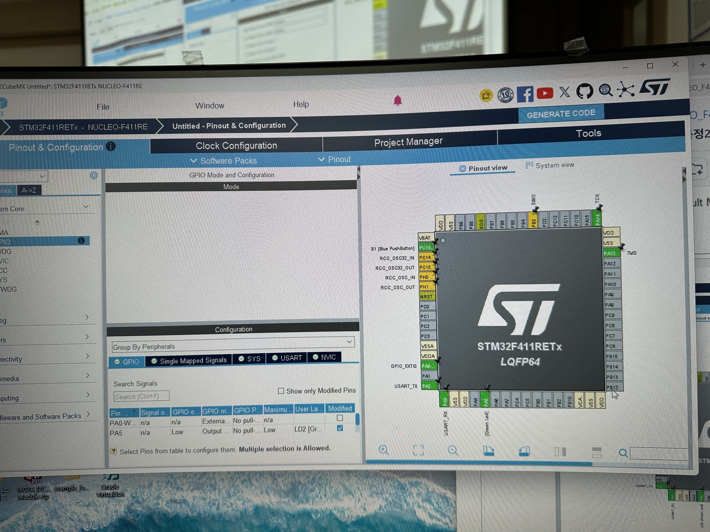
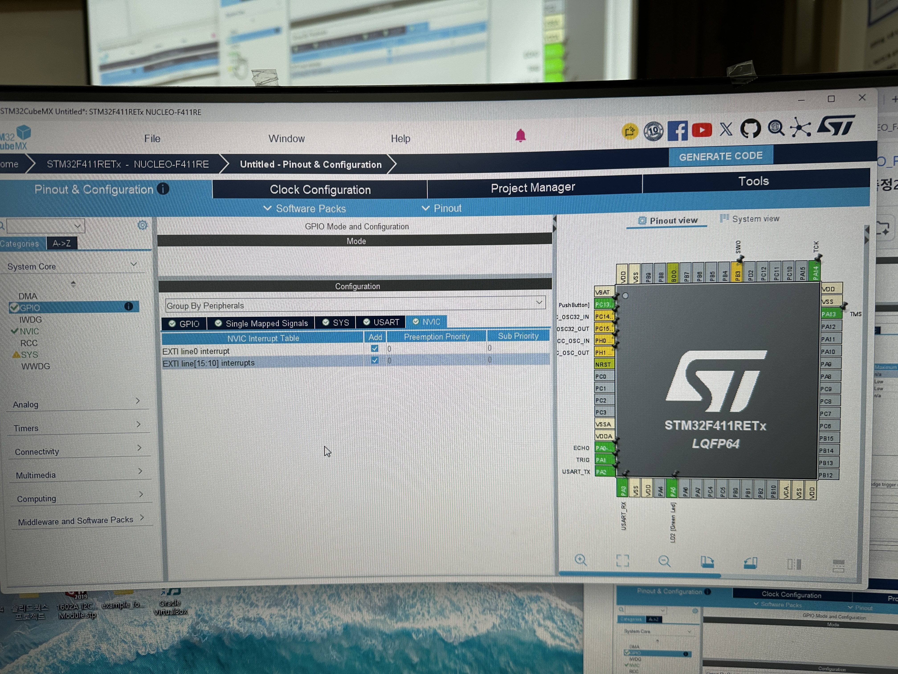
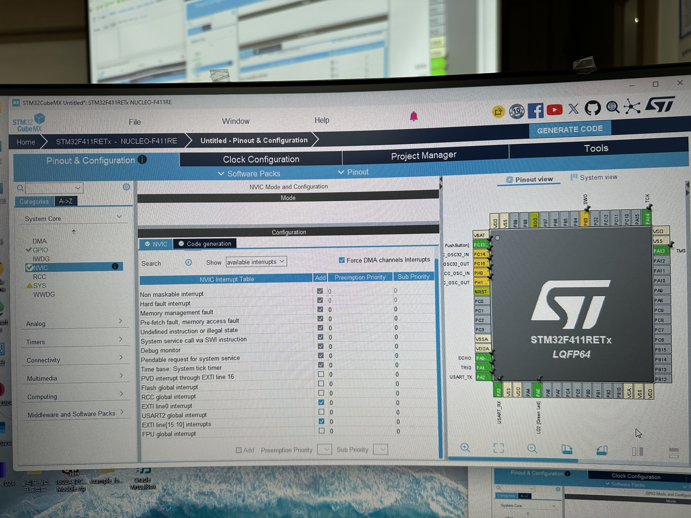
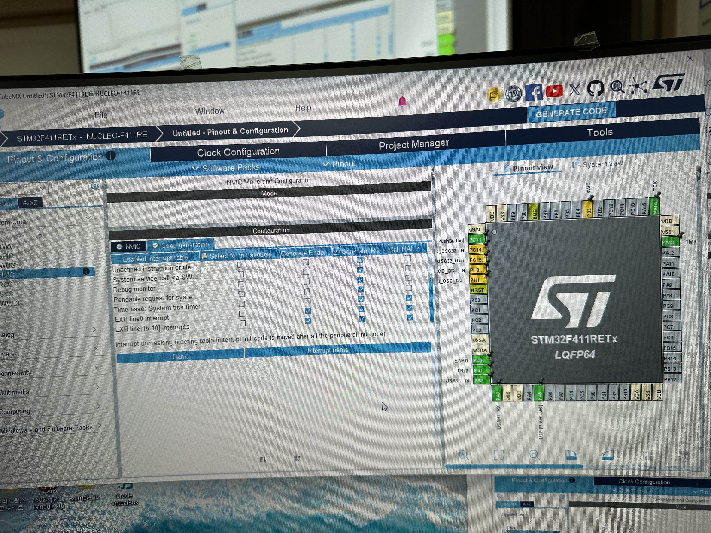
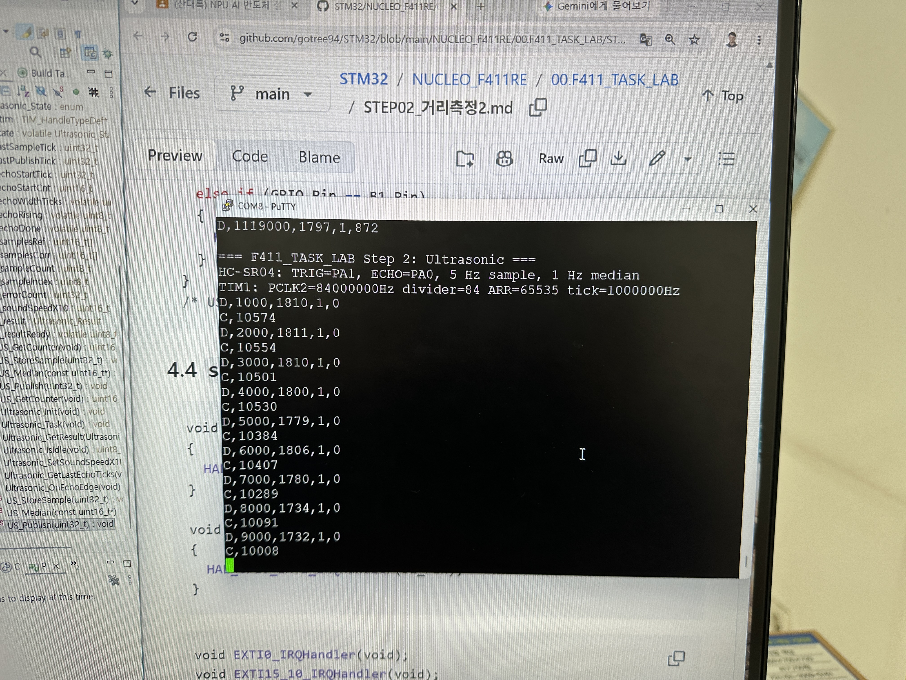
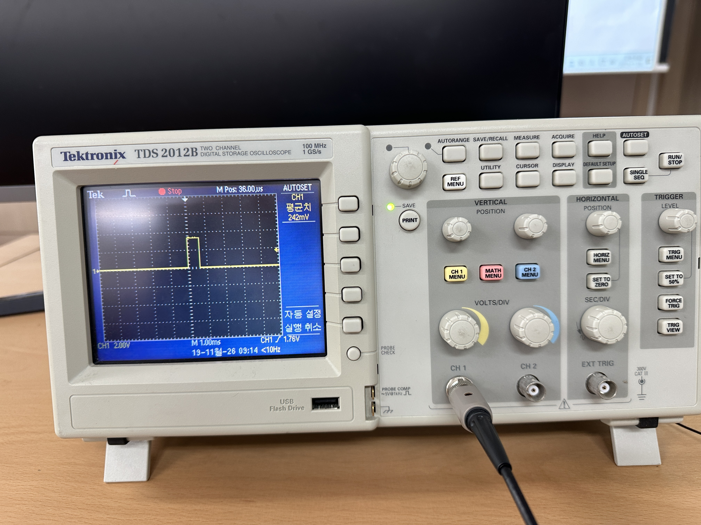
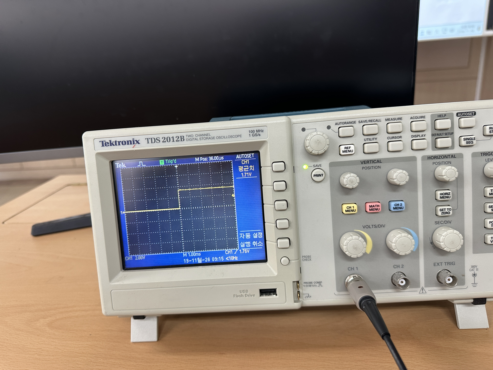
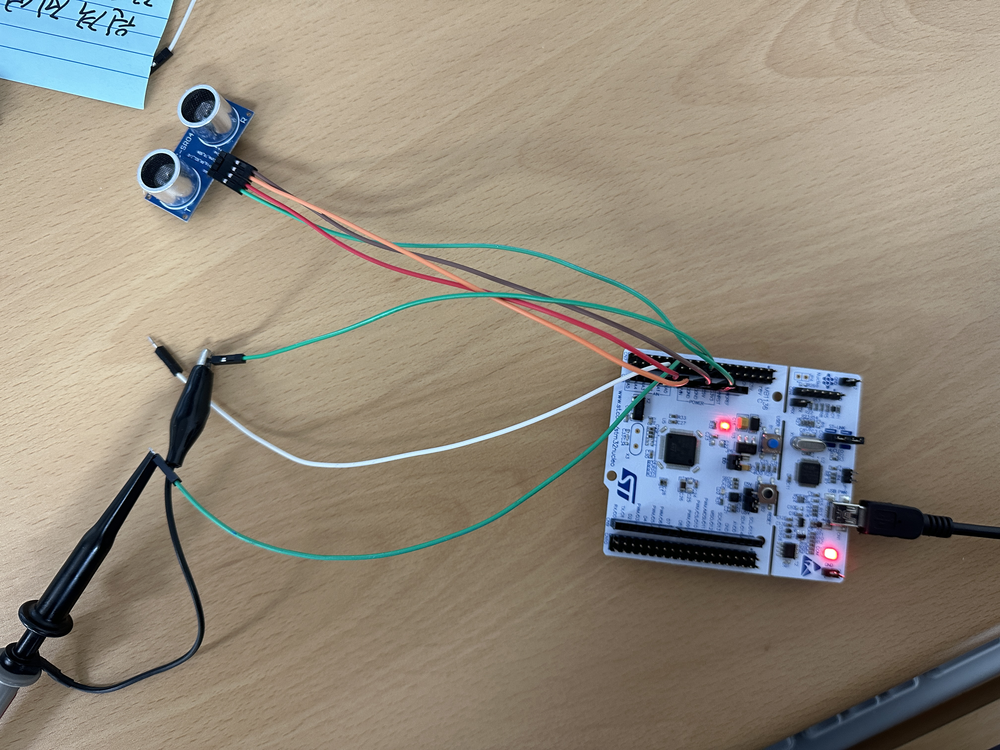

# HC_SR04

## 1. 목표

- HC-SR04로 거리를 측정한다.
- "몇 초마다 정확한 데이터를 확인한다"를 **측정 가능한 숫자**로 바꾼다.
- `HAL_Delay()` 없이 **비차단 상태 머신**으로 측정한다.
- 타임스탬프, 오류 횟수, 필터 결과를 UART CSV로 확인한다.
- LED 점멸은 계속 동작하게 두어 **여러 작업이 서로를 막지 않는지** 확인한다.

이번 단계에서 확정한 값:

| 항목 | 값 |
|---|---|
| 센서 | HC-SR04 |
| TRIG | PA1 (GPIO 출력) |
| ECHO | PA0 (EXTI 양쪽 에지) |
| 샘플 주기 | 200 ms (5 Hz) |
| 출력 주기 | 1000 ms (1 Hz) |
| 필터 | 최근 5개 중앙값 |
| 측정 타임아웃 | 35 ms |
| 유효 펄스 | 100 ~ 30000 us |
| 유효 거리 | 20 ~ 4000 mm |
| 음속 | 343 m/s (20 °C 기준) |
| 목표 정확도 | ±1 cm (0.2 ~ 2 m, 평평한 물체) |

---

## 2. 준비물

- NUCLEO-F411RE
- HC-SR04 초음파 센서
- 저항 1 kΩ, 2 kΩ 각 1개
- 점퍼선, 브레드보드
- USB 케이블 (ST-LINK, 데이터 지원)
- 시리얼 프로그램 (Tera Term / PuTTY / VS Code)
- 자 또는 줄자

---

## 3. 배선

### 3.1 HC-SR04 핀

| HC-SR04 | 연결 |
|---|---|
| VCC | NUCLEO **5 V** |
| GND | NUCLEO GND |
| TRIG | PA1 |
| ECHO | 분압 후 PA0 |

### 3.2 ECHO 전압 분압

HC-SR04의 ECHO는 **5 V 출력**이다. STM32 GPIO에 직접 연결하지 않는다.

```text
HC-SR04 ECHO ---- 1 kΩ ----+---- PA0
                           |
                          2 kΩ
                           |
                          GND
```

- PA0 전압: `5 V × 2 kΩ / (1 kΩ + 2 kΩ) ≈ 3.33 V`
- GND는 센서와 보드가 **반드시 공통**이어야 한다.
- HC-SR04는 3.3 V에서도 동작하는 것처럼 보일 수 있지만, 거리 정확도와 안정성이 떨어진다. **5 V 전원**을 사용한다.

### 3.3 연결 확인

- 전원을 넣기 전에 5 V와 GND가 바뀌지 않았는지 확인한다.
- PA0에는 분압 노드만 연결한다. ECHO를 직접 PA0에 꽂지 않는다.
- PA1은 TRIG 출력이다.
- PA0/PA1은 NUCLEO의 Arduino 아날로그 헤더 A0/A1 위치다.

---

## Hardware

### **STM32CubeMx GPIO 설정 전**

 <br>

### **STM32CubeMx GPIO PA0 설정**

 <br>

### **STM32CubeMx GPIO PA0 설정 확인**

 <br>

### **STM32CubeMx SYS TIMER1 설정 확인**

 <br>

### **STM32CubeMx NVIC 설정 확인**

 <br>

### **STM32CubeMx NVIC Code generation 설정 확인**

 <br>

#### Serial 화면 및 오실로스코프로 측정한 결과
| ** Putty 결과** | ** Oscilloscope 결과** |
| :---: | :---: |
|  |  |

#### **거리 비교 측정한 결과**
| **센서 가까이 설정** | **센서 멀리 설정** |
| :---: | :---: |
|  |  |

### **STM32F411RE Board 설**

 <br>

## Software


