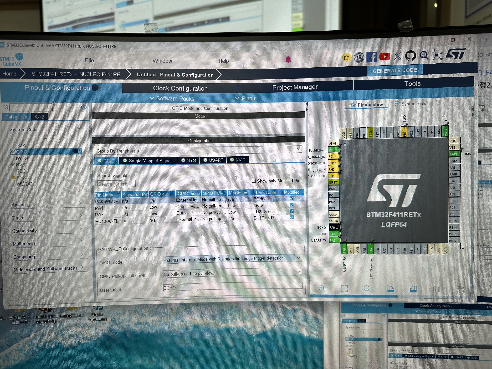
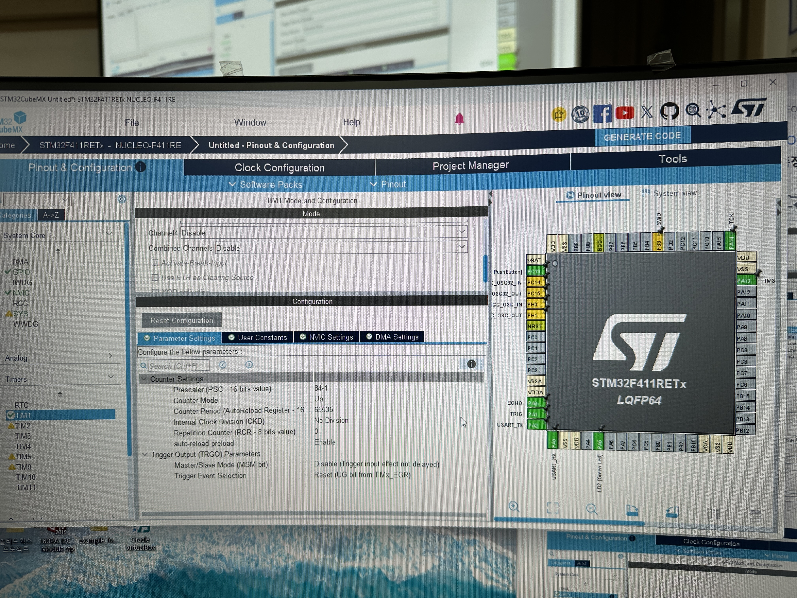
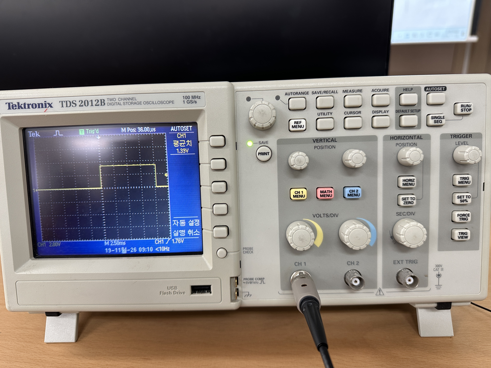

# HC_SR04

## Hardware

### **STM32CubeMx GPIO 설정 전**

  

### **STM32CubeMx GPIO PA0 설정**

  

### **STM32CubeMx GPIO PA0 설정 확인**

  

### **STM32CubeMx SYS TIMER1 설정 확인**

  

### **STM32CubeMx NVIC 설정 확인**

  

### **STM32CubeMx NVIC Code generation 설정 확인**

  

#### Serial 화면 및 오실로스코프로 측정한 결과
| ** Putty 결과** | ** Oscilloscope 결과** |
| :---: | :---: |
|  |  |

#### **거리 비교 측정한 결과**
| **센서 가까이 설정** | **센서 멀리 설정** |
| :---: | :---: |
|  |  |

### **STM32F411RE Board 설**

  

## Software

