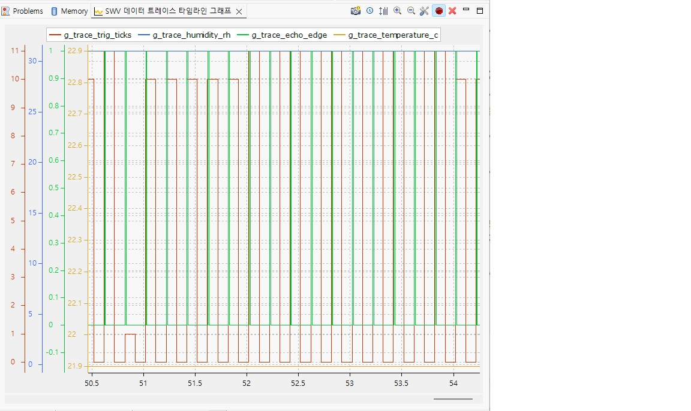

# STM32F411_Project

## DHT_Hardware

---

## 1. 기존 코드 분석 결과

| 항목 | 기존 메인 코드 상태 |
|---|---|
| MCU | STM32F411RETx, HSI → PLL 84 MHz |
| 초음파 | `TIM1` (PCLK2 84 MHz / 분주 84 = **1 MHz**, 16비트 ARR 65535), TRIG=PA1, ECHO=PA0(EXTI0) |
| 시리얼 | USART2 115200 baud, PA2/PA3, `printf` → `__io_putchar` |
| TRACE | `D,...`(거리/유효/에러), `C,...`(에코 펄스 폭) 유지 |
| 미사용 핀 | **PA4** (USART, SWD, TRIG/ECHO와 충돌 없음) → DHT DATA로 사용 |
| 미사용 타이머 | 첨부 소스가 사용하던 `TIM2`는 메인에서 초기화되지 않음 → **사용 불가** |

### 핵심 판단
첨부 소스는 마이크로초 시간 기준으로 `TIM2->CNT`를 직접 읽었지만, 메인 프로젝트에는 TIM2 초기화가 없다.
메인을 고치지 않고 **첨부 소스 쪽을 TIM1(이미 1 MHz로 구동 중)에 맞추는 것**이 요구사항에 부합하며,
타이머 추가 초기화·핀 충돌·리소스 중복을 모두 피할 수 있다.
---
## 2. 핀 / 타이머 매핑 (최종)

| 신호 | 핀 | 용도 | 비고 |
|---|---|---|---|
| ECHO | PA0 | HC-SR04 에코 | EXTI0, 기존 유지 |
| TRIG | PA1 | HC-SR04 트리거 | 기존 유지 |
| USART2_TX | PA2 | 시리얼 출력 | 기존 유지 |
| USART2_RX | PA3 | 시리얼 수신 | 기존 유지 |
| **DHT DATA** | **PA4** | 온습도 단일선 데이터 | 내부 풀업 사용, Open-Drain으로 전환 |
| LD2 | PA5 | 보드 LED | 기존 유지 |
| 시간 기준 | TIM1 | 1 MHz 카운터 | 초음파·DHT 공용 |

---
#### **초록색 부분은 온/습도 연결 핀, 빨간색 부분은 초음파 거리측정 연결 핀 설정부분**

 <br>

## 3. 변경 파일 목록

| 파일 | 변경 내용 |
|---|---|
| `Core/Inc/dht.h` | 신규 추가 (첨부 파일 그대로, `Dht_Result` / `Dht_Init` / `Dht_Task` / `Dht_GetResult`) |
| `Core/Src/dht.c` | 신규 추가 + 메인 맞춤 수정 (아래 3.1) |
| `Core/Src/main.c` | DHT 초기화·태스크 호출, 음속 보정, 시리얼 출력 추가 (아래 3.2) |
| `Debug/Core/Src/subdir.mk` | `dht.c`를 빌드 소스/오브젝트/의존성/clean에 추가 |
| `Debug/objects.list` | 링커 입력에 `./Core/Src/dht.o` 추가 |

## DHT_Software

### dht.h

```c
#ifndef DHT_H
#define DHT_H

#ifdef __cplusplus
extern "C" {
#endif

#include <stdint.h>

typedef struct
{
  uint32_t timestamp_ms;
  uint32_t errors;
  int16_t temperature_c_x10;
  uint16_t humidity_rh_x10;
  uint8_t valid;
} Dht_Result;

void Dht_Init(void);
void Dht_Task(void);
uint8_t Dht_GetResult(Dht_Result *result);

#ifdef __cplusplus
}
#endif

#endif
```

### dht.c

```c
#include "dht.h"
#include "main.h"

extern TIM_HandleTypeDef htim1;

#define DHT_PORT GPIOA
#define DHT_PIN GPIO_PIN_4

#define DHT_TIMER_TICKS_PER_US 1U

#define DHT_READ_PERIOD_MS 2000U
#define DHT_START_LOW_US 20000U
#define DHT_RELEASE_US 30U
#define DHT_RESPONSE_TIMEOUT_US 200U
#define DHT_BIT_TIMEOUT_US 200U
#define DHT_ONE_THRESHOLD_US 50U

static uint32_t s_lastReadTick;
static uint32_t s_errorCount;
static Dht_Result s_result;
static volatile uint8_t s_resultReady;

static void DHT_SetPinOutput(void);
static void DHT_SetPinInput(void);
static uint32_t DHT_NowUs(void);
static uint32_t DHT_ElapsedUs(uint32_t start);
static void DHT_DelayUs(uint32_t us);
static uint8_t DHT_WaitLevel(GPIO_PinState level, uint32_t timeout_us, uint32_t *duration);
static uint8_t DHT_ReadRaw(uint8_t *data);
static uint8_t DHT_Decode(const uint8_t *data, int32_t *temperature_c_x10, uint32_t *humidity_rh_x10);

void Dht_Init(void)
{
  GPIO_InitTypeDef gpio = {0};

  __HAL_RCC_GPIOA_CLK_ENABLE();

  gpio.Pin = DHT_PIN;
  gpio.Mode = GPIO_MODE_INPUT;
  gpio.Pull = GPIO_PULLUP;
  gpio.Speed = GPIO_SPEED_FREQ_HIGH;
  HAL_GPIO_Init(DHT_PORT, &gpio);

  s_lastReadTick = HAL_GetTick();
  s_errorCount = 0U;
  s_resultReady = 0U;
  s_result.timestamp_ms = 0U;
  s_result.errors = 0U;
  s_result.temperature_c_x10 = 0;
  s_result.humidity_rh_x10 = 0U;
  s_result.valid = 0U;
}

void Dht_Task(void)
{
  uint32_t now = HAL_GetTick();
  uint8_t data[5];
  int32_t temperature_c_x10;
  uint32_t humidity_rh_x10;
  uint8_t ok = 0U;

  if ((now - s_lastReadTick) < DHT_READ_PERIOD_MS)
  {
    return;
  }
  s_lastReadTick = now;

  DHT_SetPinOutput();
  HAL_GPIO_WritePin(DHT_PORT, DHT_PIN, GPIO_PIN_RESET);
  DHT_DelayUs(DHT_START_LOW_US);
  HAL_GPIO_WritePin(DHT_PORT, DHT_PIN, GPIO_PIN_SET);
  DHT_DelayUs(DHT_RELEASE_US);
  DHT_SetPinInput();

  if (DHT_ReadRaw(data) != 0U)
  {
    uint8_t checksum = (uint8_t)(data[0] + data[1] + data[2] + data[3]);

    if (checksum == data[4])
    {
      if (DHT_Decode(data, &temperature_c_x10, &humidity_rh_x10) != 0U)
      {
        s_result.temperature_c_x10 = (int16_t)temperature_c_x10;
        s_result.humidity_rh_x10 = (uint16_t)humidity_rh_x10;
        s_result.valid = 1U;
        ok = 1U;
      }
    }
  }

  if (ok == 0U)
  {
    s_result.valid = 0U;
    s_errorCount++;
  }

  s_result.timestamp_ms = now;
  s_result.errors = s_errorCount;
  s_resultReady = 1U;
}

uint8_t Dht_GetResult(Dht_Result *result)
{
  if ((result == NULL) || (s_resultReady == 0U))
  {
    return 0U;
  }

  *result = s_result;
  s_resultReady = 0U;
  return 1U;
}

static void DHT_SetPinOutput(void)
{
  GPIO_InitTypeDef gpio = {0};

  gpio.Pin = DHT_PIN;
  gpio.Mode = GPIO_MODE_OUTPUT_OD;
  gpio.Pull = GPIO_PULLUP;
  gpio.Speed = GPIO_SPEED_FREQ_HIGH;
  HAL_GPIO_Init(DHT_PORT, &gpio);
}

static void DHT_SetPinInput(void)
{
  GPIO_InitTypeDef gpio = {0};

  gpio.Pin = DHT_PIN;
  gpio.Mode = GPIO_MODE_INPUT;
  gpio.Pull = GPIO_PULLUP;
  gpio.Speed = GPIO_SPEED_FREQ_HIGH;
  HAL_GPIO_Init(DHT_PORT, &gpio);
}

static uint32_t DHT_NowUs(void)
{
  return (uint32_t)(__HAL_TIM_GET_COUNTER(&htim1) / DHT_TIMER_TICKS_PER_US);
}

static uint32_t DHT_ElapsedUs(uint32_t start)
{
  return (uint16_t)(DHT_NowUs() - start);
}

static void DHT_DelayUs(uint32_t us)
{
  uint32_t start = DHT_NowUs();

  while (DHT_ElapsedUs(start) < us)
  {
  }
}

static uint8_t DHT_WaitLevel(GPIO_PinState level, uint32_t timeout_us, uint32_t *duration)
{
  uint32_t start = DHT_NowUs();

  while (HAL_GPIO_ReadPin(DHT_PORT, DHT_PIN) != level)
  {
    if (DHT_ElapsedUs(start) >= timeout_us)
    {
      return 0U;
    }
  }

  if (duration != NULL)
  {
    *duration = DHT_ElapsedUs(start);
  }

  return 1U;
}

static uint8_t DHT_ReadRaw(uint8_t *data)
{
  uint32_t duration;
  uint8_t i;
  uint8_t bit;

  for (i = 0U; i < 5U; i++)
  {
    data[i] = 0U;
  }

  if (DHT_WaitLevel(GPIO_PIN_RESET, DHT_RESPONSE_TIMEOUT_US, NULL) == 0U)
  {
    return 0U;
  }
  if (DHT_WaitLevel(GPIO_PIN_SET, DHT_RESPONSE_TIMEOUT_US, NULL) == 0U)
  {
    return 0U;
  }

  for (i = 0U; i < 40U; i++)
  {
    if (DHT_WaitLevel(GPIO_PIN_RESET, DHT_BIT_TIMEOUT_US, NULL) == 0U)
    {
      return 0U;
    }
    if (DHT_WaitLevel(GPIO_PIN_SET, DHT_BIT_TIMEOUT_US, NULL) == 0U)
    {
      return 0U;
    }
    if (DHT_WaitLevel(GPIO_PIN_RESET, DHT_BIT_TIMEOUT_US, &duration) == 0U)
    {
      return 0U;
    }

    bit = (duration > DHT_ONE_THRESHOLD_US) ? 1U : 0U;
    data[i / 8U] = (uint8_t)((data[i / 8U] << 1U) | bit);
  }

  return 1U;
}

static uint8_t DHT_Decode(const uint8_t *data, int32_t *temperature_c_x10, uint32_t *humidity_rh_x10)
{
  uint32_t humidity;
  int32_t temperature;

  humidity = ((uint32_t)data[0] << 8) | data[1];
  temperature = (int32_t)(((uint16_t)(data[2] & 0x7FU) << 8) | data[3]);
  if ((data[2] & 0x80U) != 0U)
  {
    temperature = -temperature;
  }

  if ((humidity <= 1000U) && (temperature >= -400) && (temperature <= 800))
  {
    *humidity_rh_x10 = humidity;
    *temperature_c_x10 = temperature;
    return 1U;
  }

  if ((data[1] <= 9U) && (data[3] <= 9U))
  {
    humidity = ((uint32_t)data[0] * 10U) + data[1];
    temperature = ((int32_t)data[2] * 10) + (int32_t)data[3];

    if ((humidity <= 1000U) && (temperature >= 0) && (temperature <= 800))
    {
      *humidity_rh_x10 = humidity;
      *temperature_c_x10 = temperature;
      return 1U;
    }
  }

  return 0U;
}
```

### main.c

```c
/* USER CODE BEGIN Includes */
#include <stdio.h>
#include "ultrasonic.h"
#include "dht.h"
/* USER CODE END Includes */
```

```c
/* USER CODE BEGIN 0 */
#ifdef __GNUC__
#define PUTCHAR_PROTOTYPE int __io_putchar(int ch)
#else
#define PUTCHAR_PROTOTYPE int fputc(int ch, FILE *f)
#endif

PUTCHAR_PROTOTYPE
{
  if (ch == '\n')
  {
    HAL_UART_Transmit(&huart2, (uint8_t *)"\r", 1, 0xFFFF);
  }
  HAL_UART_Transmit(&huart2, (uint8_t *)&ch, 1, 0xFFFF);

  return ch;
}

static uint16_t Sensor_SoundSpeedX10(int16_t temperature_c_x10, uint16_t humidity_rh_x10)
{
  int32_t speed_x10;

  speed_x10 = 3313 + ((606 * (int32_t)temperature_c_x10) / 1000);
  speed_x10 += (12 * (int32_t)humidity_rh_x10) / 1000;

  if (speed_x10 < 2500)
  {
    speed_x10 = 2500;
  }
  else if (speed_x10 > 4000)
  {
    speed_x10 = 4000;
  }

  return (uint16_t)speed_x10;
}

static void Sensor_Task(void)
{
  Ultrasonic_Result result;
  Dht_Result dht;
  char line[96];
  int32_t temperature;

  Dht_Task();
  Ultrasonic_Task();

  if (Dht_GetResult(&dht) != 0U)
  {
    temperature = (int32_t)dht.temperature_c_x10;
    (void)snprintf(line, sizeof(line), "TH,%lu,%d,%u,%u,%lu\n",
                   (unsigned long)dht.timestamp_ms,
                   (int)temperature,
                   (unsigned int)dht.humidity_rh_x10,
                   (unsigned int)dht.valid,
                   (unsigned long)dht.errors);
    printf("%s", line);
    printf("ENV,%c%u.%uC,%u.%u%%RH\n",
           (temperature < 0) ? '-' : '+',
           (unsigned int)((temperature < 0) ? -temperature : temperature) / 10U,
           (unsigned int)((temperature < 0) ? -temperature : temperature) % 10U,
           (unsigned int)dht.humidity_rh_x10 / 10U,
           (unsigned int)dht.humidity_rh_x10 % 10U);

    if (dht.valid != 0U)
    {
      uint16_t speed_x10 = Sensor_SoundSpeedX10(dht.temperature_c_x10,
                                                dht.humidity_rh_x10);
      Ultrasonic_SetSoundSpeedX10(speed_x10);
      printf("S,%u\n", (unsigned int)speed_x10);
    }
  }

  if (Ultrasonic_GetResult(&result) != 0U)
  {
    (void)snprintf(line, sizeof(line), "D,%lu,%u,%u,%lu\n",
                   (unsigned long)result.timestamp_ms,
                   (unsigned int)result.distance_mm,
                   (unsigned int)result.valid,
                   (unsigned long)result.errors);
    printf("%s", line);
    printf("C,%u\n", (unsigned int)Ultrasonic_GetLastEchoTicks());
  }
}
/* USER CODE END 0 */
```

```c
  /* USER CODE BEGIN 2 */
  Ultrasonic_Init();
  Dht_Init();
  printf("\n=== F411_TASK_LAB Step 3: Ultrasonic + DHT ===\n");
  printf("HC-SR04: TRIG=PA1, ECHO=PA0, 5 Hz sample, 1 Hz median\n");
  printf("DHTxx: DATA=PA4, 2 s sample, TIM1 1 MHz timebase\n");
  printf("TIM1: PCLK2=%luHz divider=%lu ARR=%lu tick=%luHz\n",
         (unsigned long)HAL_RCC_GetPCLK2Freq(),
         (unsigned long)(htim1.Init.Prescaler + 1U),
         (unsigned long)htim1.Init.Period,
         (unsigned long)(HAL_RCC_GetPCLK2Freq() / (htim1.Init.Prescaler + 1U)));
  /* USER CODE END 2 */
```

```c
  /* Infinite loop */
  /* USER CODE BEGIN WHILE */
  while (1)
  {
    /* USER CODE END WHILE */

    /* USER CODE BEGIN 3 */
    Sensor_Task();
  }
  /* USER CODE END 3 */
```


> Eclipse/STM32CubeIDE에서 다시 빌드하면 `subdir.mk`와 `objects.list`는 `.cproject`의 `Core` 소스 경로로부터 자동 재생성되며, `Core/Src/dht.c`가 자동 포함된다. 위 수정은 커맨드라인 `make` 즉시 빌드를 위해 반영한 것이다.

### 3.1 `dht.c` 수정 내용 (첨부 소스 → 메인 적합화)

1. **타이머 기준 교체**
   - `TIM2->CNT` 제거 → `__HAL_TIM_GET_COUNTER(&htim1)` 사용 (`extern TIM_HandleTypeDef htim1;` 추가)
   - `DHT_TIMER_TICKS_PER_US = 1U` 정의로 메인의 1 MHz 설정을 명시
   - `Ultrasonic_Init()`에서 TIM1을 먼저 시작하므로 `Dht_Init()`은 그 이후에 호출

2. **16비트 카운터 랩어라운드 처리**
   - TIM1은 16비트(65.536 ms 주기)이므로 기존의 `uint32_t` 뺄셈은 오버플로 시 오동작
   - `DHT_ElapsedUs(start)`를 추가하여 `(uint16_t)(now - start)`로 모든 지연/타임아웃/비트 폭 측정 통일
   - 20 ms 시작 신호와 40비트 수신(약 4~5 ms)이 카운터 경계를 지나도 정상 동작

3. **나머지 로직은 첨부 소스 유지**
   - 20 ms LOW → 30 µs release → 응답 검출 → 40비트 MSB-first 수신
   - HIGH 펄스 폭이 50 µs 초과이면 `1`, 이하이면 `0`
   - 체크섬 검증, DHT22(16비트) / DHT11(정수+소수 8비트) 자동 디코딩, 범위 필터링 유지
   - 2초 주기, 에러 카운트, `valid` 플래그, `Dht_GetResult()` 원-샷 전달 구조 유지

### 3.2 `main.c` 수정 내용

1. `#include "dht.h"` 추가 (`Core/Src/main.c:26`)
2. 초기화 순서: `Ultrasonic_Init();` → `Dht_Init();` (`Core/Src/main.c:181-182`)
3. 부팅 배너를 Step 3로 갱신하고 DHT 핀/타이머 정보 출력 (`Core/Src/main.c:183-185`)
4. `Sensor_Task()`에서 `Dht_Task()`를 `Ultrasonic_Task()` 앞에 호출 (`Core/Src/main.c:107`)
5. 음속 보정 함수 `Sensor_SoundSpeedX10()` 추가 (`Core/Src/main.c:81-98`)
6. DHT 결과를 시리얼로 출력하고, 유효할 때만 음속을 갱신 (`Core/Src/main.c:110-134`)

---

## 4. 정확도 개선 원리 (음속 보정)

초음파 거리는 `거리 = (에코시간 × 음속) / 2` 이므로 음속 오차가 그대로 거리 오차가 된다.
기존은 고정 음속 3430 ×0.1 m/s(20 °C 기준)를 사용했으나, 온도/습도에 따라 실제 음속은 변한다.

```
v [0.1 m/s] = 3313 + (606 × T_x10) / 1000 + (12 × RH_x10) / 1000
```

- `T_x10` = 온도 ×10 (0.1 °C 단위), `RH_x10` = 습도 ×10 (0.1 %RH 단위)
- 온도항: 0.606 m/s/°C, 습도항: 약 0.0124 m/s/%RH 를 정수 연산으로 근사
- 예) 20.5 °C, 50.3 %RH → 약 3441 (344.1 m/s) → `Ultrasonic_SetSoundSpeedX10()`에 반영
- 보정 결과는 `distance_ref_mm`(고정 음속)와 `distance_mm`(보정 음속)를 함께 두어 비교 가능
- `2500 ~ 4000` 범위 클램프로 비정상 값이 거리 계산에 반영되지 않도록 보호

---

## 5. 시리얼 출력 포맷 (115200 baud)

기존 TRACE는 그대로 유지하고, 온습도 라인을 추가했다.

| 프리픽스 | 형식 | 설명 |
|---|---|---|
| `D` | `D,<time_ms>,<distance_mm>,<valid>,<errors>` | 기존: 보정 음속 적용 거리 (1 Hz) |
| `C` | `C,<echo_ticks>` | 기존: 마지막 에코 펄스 폭 (1 MHz 카운트 = µs) |
| **`TH`** | `TH,<time_ms>,<temp_x10>,<rh_x10>,<valid>,<errors>` | **신규: 온도/습도 원시값(×10), 2 초 주기** |
| **`ENV`** | `ENV,<+/-><T>.<t>C,<RH>.<r>%RH` | **신규: 사람이 읽기 쉬운 온습도** |
| **`S`** | `S,<speed_x10>` | **신규: DHT 유효 시 적용된 음속 (유효하지 않으면 미출력)** |

출력 예시:

```
=== F411_TASK_LAB Step 3: Ultrasonic + DHT ===
HC-SR04: TRIG=PA1, ECHO=PA0, 5 Hz sample, 1 Hz median
DHTxx: DATA=PA4, 2 s sample, TIM1 1 MHz timebase
D,10234,512,1,0
C,2981
TH,10400,205,503,1,0
ENV,+20.5C,50.3%RH
S,3441
D,11234,510,1,0
C,2968
```

#### 초음파 거리 측정 과 온습도 측정을 같이 적용한 데이터 트레이스 타임라인 그래프

 <br>

---

## 최종 작업 정리 — 초음파 + 온습도 + FreeRTOS

### FreeRTOS_HardWare
---

#### 1. 전체 작업 흐름

| 단계 | 내용 | 메인 코드 변경 여부 |
|---|---|---|
| Step 2 (기존) | HC-SR04 거리 측정 + TRACE (`D`, `C`) | 이미 완료 |
| Step 3 | DHT 온습도 추가, 음속 보정, `TH`/`ENV`/`S` 출력 | `main.c` + 첨부 `dht.c/.h` 수정 |
| Step 4 (현재) | CubeMX에서 FreeRTOS 추가, 태스크 분리, UART mutex | `.ioc` 재생성 + `main.c` USER 코드 수정 |

핵심 원칙: **메인 프로젝트를 기준으로 두고, 첨부 소스(`dht.c/.h`)를 메인에 맞췄으며**, FreeRTOS 전환은 `.ioc`를 직접 수정해 CubeMX가 코드를 생성하도록 했습니다.

---

#### 2. CubeMX에서 실제 반영된 설정

##### 2.1 Middleware / NVIC / Clock

| 항목 | 최종 값 | 비고 |
|---|---|---|
| FREERTOS Interface | `CMSIS_V2` | `VP_FREERTOS_VS_CMSIS_V2.Mode=CMSIS_V2` |
| `configTOTAL_HEAP_SIZE` | `16384` | 태스크 3개 + 대기 여유 확보 |
| `configTICK_RATE_HZ` | 1000 | 1 ms tick |
| `configUSE_PREEMPTION` | 1 | 선점형 스케줄링 |
| `configUSE_MUTEXES` | 1 | `myMutex01` 사용 |
| `configLIBRARY_MAX_SYSCALL_INTERRUPT_PRIORITY` | 5 | EXTI 우선순위 5와 매칭 |
| NVIC Priority Group | `NVIC_PRIORITYGROUP_4` | "4 bits for pre-emption priority" |
| EXTI0 / EXTI15_10 우선순위 | 5 | `HAL_NVIC_SetPriority(..., 5, 0)` 생성됨 |
| SYS Timebase Source | **SysTick 유지** | 아래 참고 참고 |

> **참고 (TIM2 권장안에 대한 정정):** 처음에는 HAL timebase를 TIM2로 옮기는 것을 권장했습니다. 그러나 생성된 코드에서 `stm32f4xx_it.c`의 `SysTick_Handler()`가 `HAL_IncTick()`과 `xPortSysTickHandler()`를 **함께 호출**하고, `USE_CUSTOM_SYSTICK_HANDLER_IMPLEMENTATION=1`로 `cmsis_os2.c`의 중복 핸들러가 비활성화됩니다. 따라서 **SysTick을 그대로 두어도 충돌이 없으며**, 실제 프로젝트도 SysTick으로 정상 빌드·동작합니다. TIM2로 옮기는 것은 선택 사항입니다.

##### 2.2 태스크 / 뮤텍스 (실제 생성된 값)

| 이름 | 우선순위 | 스택 | Entry 함수 | 역할 |
|---|---|---|---|---|
| `defaultTask` | 24 (Normal) | 128 words | `StartDefaultTask` | 대기용, `osDelay(1)` |
| `myTask02` | 24 (Normal) | 256 words | `StartUltrasonicTask` | 초음파 폴링 + `D`/`C` 출력 |
| `myTask03` | 25 (Normal+1) | 256 words | `StartDhtTask` | DHT 읽기 + `TH`/`ENV`/`S` 출력 |
| `myMutex01` | Dynamic | — | — | UART(`printf`) 접근 직렬화 |

- 생성된 태스크 함수는 `freertos.c`가 아니라 **`main.c`** 안에 만들어졌습니다.
- `main()`에서 `osKernelInitialize()` → `osMutexNew()` → `osThreadNew()` 3회 → `osKernelStart()` 순서로 생성됩니다.

##### 2.3 유지한 설정

- `TIM1`: Prescaler `84-1`, ARR `65535` → 1 MHz 카운터 (초음파 + DHT 공용 시간 기준)
- `USART2`: 115200-8N1, PA2/PA3
- GPIO: PA0 ECHO, PA1 TRIG, PA5 LD2
- **PA4는 `.ioc`에 할당하지 않음** — `dht.c`가 런타임에 입력/OD로 전환

---

#### 3. 코드 변경 내용

##### 3.1 `Core/Src/dht.c`, `Core/Inc/dht.h` (Step 3)

- 첨부 소스의 미초기화 `TIM2->CNT` 제거 → `__HAL_TIM_GET_COUNTER(&htim1)` 사용
- `DHT_ElapsedUs(start)`를 두어 `(uint16_t)(now - start)`로 16비트 랩어라운드 처리
- 20 ms LOW → 30 µs release → 응답 → 40비트 수신, 50 µs 기준으로 0/1 판별
- 체크섬 검증 + DHT22/DHT11 자동 디코딩, 2초 주기, 에러 카운트 유지


##### 3.2 `Core/Src/main.c` (Step 4)

| 위치 | 변경 |
|---|---|
| Includes | `#include "cmsis_os.h"`(생성), `#include "dht.h"` 유지 |
| USER CODE 0 | `Sensor_SoundSpeedX10()`만 유지, 기존 `Sensor_Task()` 전체 제거 |
| USER CODE 2 | `Ultrasonic_Init()`, `Dht_Init()` 유지 + Step 4 배너 및 태스크 주기 출력 추가 |
| while(1) | `Sensor_Task()` 호출 제거 (스케줄러가 점유하므로 도달하지 않음) |
| `StartUltrasonicTask` | 10 ms 주기 `Ultrasonic_Task()` → 결과 발생 시 mutex 안에서 `D`, `C` 출력 → `osDelay(10)` |
| `StartDhtTask` | 100 ms 주기 `Dht_Task()` → 결과 발생 시 mutex 안에서 `TH`, `ENV`, `S` 출력 + 음속 갱신 → `osDelay(100)` |
| `HAL_GPIO_EXTI_Callback` | 유지 (`Ultrasonic_OnEchoEdge()`, B1 LED 토글). RTOS API를 호출하지 않아 우선순위 5에서 안전 |

음속 보정 수식(`Sensor_SoundSpeedX10`):

```
speed_x10 = 3313 + (606 × T_x10) / 1000 + (12 × RH_x10) / 1000
```

- `T_x10` = 온도 ×10 (0.1 °C), `RH_x10` = 습도 ×10 (0.1 %RH)
- 2500~4000 범위로 클램프, `dht.valid == 1`일 때만 `Ultrasonic_SetSoundSpeedX10()` 호출

### FreeRTOS_SoftWare
---
```c
/* USER CODE END Header */
/* Includes ------------------------------------------------------------------*/
#include "main.h"
#include "cmsis_os.h"

/* Private includes ----------------------------------------------------------*/
/* USER CODE BEGIN Includes */
#include <stdio.h>
#include "ultrasonic.h"
#include "dht.h"
/* USER CODE END Includes */
```

```c
/* Private variables ---------------------------------------------------------*/
TIM_HandleTypeDef htim1;

UART_HandleTypeDef huart2;

/* Definitions for defaultTask */
osThreadId_t defaultTaskHandle;
const osThreadAttr_t defaultTask_attributes = {
  .name = "defaultTask",
  .stack_size = 128 * 4,
  .priority = (osPriority_t) osPriorityNormal,
};
/* Definitions for myTask02 */
osThreadId_t myTask02Handle;
const osThreadAttr_t myTask02_attributes = {
  .name = "myTask02",
  .stack_size = 256 * 4,
  .priority = (osPriority_t) osPriorityNormal,
};
/* Definitions for myTask03 */
osThreadId_t myTask03Handle;
const osThreadAttr_t myTask03_attributes = {
  .name = "myTask03",
  .stack_size = 256 * 4,
  .priority = (osPriority_t) osPriorityNormal1,
};
/* Definitions for myMutex01 */
osMutexId_t myMutex01Handle;
const osMutexAttr_t myMutex01_attributes = {
  .name = "myMutex01"
};
/* USER CODE BEGIN PV */

/* USER CODE END PV */
```

```c
  /* USER CODE BEGIN 2 */
  Ultrasonic_Init();
  Dht_Init();
  printf("\n=== F411_TASK_LAB Step 4: FreeRTOS Ultrasonic + DHT ===\n");
  printf("HC-SR04: TRIG=PA1, ECHO=PA0, 5 Hz sample, 1 Hz median\n");
  printf("DHTxx: DATA=PA4, 2 s sample, TIM1 1 MHz timebase\n");
  printf("Tasks: US=10 ms poll, DHT=100 ms poll, UART mutex\n");
  printf("TIM1: PCLK2=%luHz divider=%lu ARR=%lu tick=%luHz\n",
         (unsigned long)HAL_RCC_GetPCLK2Freq(),
         (unsigned long)(htim1.Init.Prescaler + 1U),
         (unsigned long)htim1.Init.Period,
         (unsigned long)(HAL_RCC_GetPCLK2Freq() / (htim1.Init.Prescaler + 1U)));
  /* USER CODE END 2 */
```

```c
  /* Init scheduler */
  osKernelInitialize();
  /* Create the mutex(es) */
  /* creation of myMutex01 */
  myMutex01Handle = osMutexNew(&myMutex01_attributes);

  /* USER CODE BEGIN RTOS_MUTEX */
  /* add mutexes, ... */
  /* USER CODE END RTOS_MUTEX */

  /* USER CODE BEGIN RTOS_SEMAPHORES */
  /* add semaphores, ... */
  /* USER CODE END RTOS_SEMAPHORES */

  /* USER CODE BEGIN RTOS_TIMERS */
  /* start timers, add new ones, ... */
  /* USER CODE END RTOS_TIMERS */

  /* USER CODE BEGIN RTOS_QUEUES */
  /* add queues, ... */
  /* USER CODE END RTOS_QUEUES */

  /* Create the thread(s) */
  /* creation of defaultTask */
  defaultTaskHandle = osThreadNew(StartDefaultTask, NULL, &defaultTask_attributes);

  /* creation of myTask02 */
  myTask02Handle = osThreadNew(StartUltrasonicTask, NULL, &myTask02_attributes);

  /* creation of myTask03 */
  myTask03Handle = osThreadNew(StartDhtTask, NULL, &myTask03_attributes);

  /* USER CODE BEGIN RTOS_THREADS */
  /* add threads, ... */
  /* USER CODE END RTOS_THREADS */

  /* USER CODE BEGIN RTOS_EVENTS */
  /* add events, ... */
  /* USER CODE END RTOS_EVENTS */

  /* Start scheduler */
  osKernelStart();

  /* We should never get here as control is now taken by the scheduler */
```

* /* USER CODE END 4 */ 아래

```c
/* USER CODE BEGIN Header_StartDefaultTask */
/**
  * @brief  Function implementing the defaultTask thread.
  * @param  argument: Not used
  * @retval None
  */
/* USER CODE END Header_StartDefaultTask */
void StartDefaultTask(void *argument)
{
  /* USER CODE BEGIN 5 */
  /* Infinite loop */
  for(;;)
  {
    osDelay(1);
  }
  /* USER CODE END 5 */
}
```

```c
/* USER CODE BEGIN Header_StartUltrasonicTask */
/**
* @brief Function implementing the myTask02 thread.
* @param argument: Not used
* @retval None
*/
/* USER CODE END Header_StartUltrasonicTask */
void StartUltrasonicTask(void *argument)
{
  /* USER CODE BEGIN StartUltrasonicTask */
  Ultrasonic_Result result;
  char line[80];

  for(;;)
  {
    Ultrasonic_Task();

    if (Ultrasonic_GetResult(&result) != 0U)
    {
      (void)snprintf(line, sizeof(line), "D,%lu,%u,%u,%lu\n",
                     (unsigned long)result.timestamp_ms,
                     (unsigned int)result.distance_mm,
                     (unsigned int)result.valid,
                     (unsigned long)result.errors);

      (void)osMutexAcquire(myMutex01Handle, osWaitForever);
      printf("%s", line);
      printf("C,%u\n", (unsigned int)Ultrasonic_GetLastEchoTicks());
      (void)osMutexRelease(myMutex01Handle);
    }

    osDelay(10);
  }
  /* USER CODE END StartUltrasonicTask */
}
```

```c
/* USER CODE BEGIN Header_StartDhtTask */
/**
* @brief Function implementing the myTask03 thread.
* @param argument: Not used
* @retval None
*/
/* USER CODE END Header_StartDhtTask */
void StartDhtTask(void *argument)
{
  /* USER CODE BEGIN StartDhtTask */
  Dht_Result dht;
  char line[96];
  int32_t temperature;
  uint16_t speed_x10;

  for(;;)
  {
    Dht_Task();

    if (Dht_GetResult(&dht) != 0U)
    {
      temperature = (int32_t)dht.temperature_c_x10;
      (void)snprintf(line, sizeof(line), "TH,%lu,%d,%u,%u,%lu\n",
                     (unsigned long)dht.timestamp_ms,
                     (int)temperature,
                     (unsigned int)dht.humidity_rh_x10,
                     (unsigned int)dht.valid,
                     (unsigned long)dht.errors);

      (void)osMutexAcquire(myMutex01Handle, osWaitForever);
      printf("%s", line);
      printf("ENV,%c%u.%uC,%u.%u%%RH\n",
             (temperature < 0) ? '-' : '+',
             (unsigned int)((temperature < 0) ? -temperature : temperature) / 10U,
             (unsigned int)((temperature < 0) ? -temperature : temperature) % 10U,
             (unsigned int)dht.humidity_rh_x10 / 10U,
             (unsigned int)dht.humidity_rh_x10 % 10U);

      if (dht.valid != 0U)
      {
        speed_x10 = Sensor_SoundSpeedX10(dht.temperature_c_x10,
                                         dht.humidity_rh_x10);
        Ultrasonic_SetSoundSpeedX10(speed_x10);
        printf("S,%u\n", (unsigned int)speed_x10);
      }
      (void)osMutexRelease(myMutex01Handle);
    }

    osDelay(100);
  }
  /* USER CODE END StartDhtTask */
}
```

---

## 4. 태스크 동작 타이밍

```
[FreeRTOS 1 ms tick]
 myTask03(DHT)     : 100 ms마다 Dht_Task() 호출 → 내부 2 s 게이트 → 실제 읽기 2 s마다 1회 (약 24 ms 블로킹)
 myTask02(US)      : 10 ms마다 Ultrasonic_Task() → 내부 200 ms 샘플 / 1000 ms 퍼블리시 → D, C 출력 1 Hz
 defaultTask       : osDelay(1) 대기
 ISR(EXTI0)        : 에코 엣지에서 TIM1 카운터만 읽어 펄스 폭 저장 (인터럽트 우선순위 5)
```

- DHT가 24 ms 블로킹해도 초음파 샘플 주기(200 ms)와 에코 타임아웃(35 ms)보다 짧아 충돌하지 않습니다.
- 음속 값(`uint16_t`) 갱신은 DHT 태스크, 참조는 초음파 태스크에서 이루어지지만 32비트 코어에서 16비트 대입은 원자적이라 별도 동기화가 필요 없습니다.

---

## 5. 시리얼 출력 (115200-8N1)

| 프리픽스 | 형식 | 발생 주기 |
|---|---|---|
| `D` | `D,<time_ms>,<distance_mm>,<valid>,<errors>` | 1 Hz (음속 보정 적용) |
| `C` | `C,<echo_ticks>` | 1 Hz (에코 폭, 1 MHz = µs) |
| `TH` | `TH,<time_ms>,<temp_x10>,<rh_x10>,<valid>,<errors>` | 2 s |
| `ENV` | `ENV,<+/-><T>.<t>C,<RH>.<r>%RH` | 2 s |
| `S` | `S,<speed_x10>` | DHT 유효 시 2 s |

예시:

```
=== F411_TASK_LAB Step 4: FreeRTOS Ultrasonic + DHT ===
HC-SR04: TRIG=PA1, ECHO=PA0, 5 Hz sample, 1 Hz median
DHTxx: DATA=PA4, 2 s sample, TIM1 1 MHz timebase
Tasks: US=10 ms poll, DHT=100 ms poll, UART mutex
D,10234,512,1,0
C,2981
TH,10400,205,503,1,0
ENV,+20.5C,50.3%RH
S,3441
```
