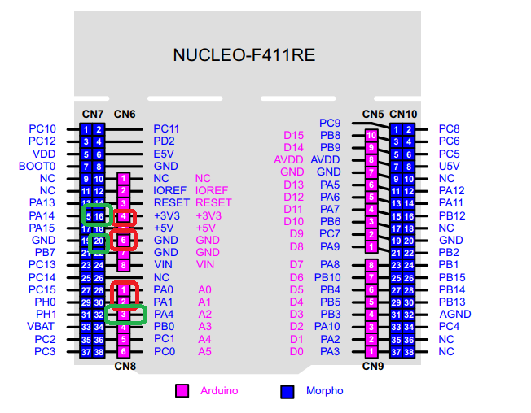

# STM32F411_Project

# TASK_LAB
- [1. Distance sensor](./README.md)
- [2. temp/humi sensor](./README.md)

## Hardware

---

## 1. 기존 코드 분석 결과

| 항목 | 기존 메인 코드 상태 |
|---|---|
| MCU | STM32F411RETx, HSI → PLL 84 MHz |
| 초음파 | `TIM1` (PCLK2 84 MHz / 분주 84 = **1 MHz**, 16비트 ARR 65535), TRIG=PA1, ECHO=PA0(EXTI0) |
| 시리얼 | USART2 115200 baud, PA2/PA3, `printf` → `__io_putchar` |
| TRACE | `D,...`(거리/유효/에러), `C,...`(에코 펄스 폭) 유지 |
| 미사용 핀 | **PA4** (USART, SWD, TRIG/ECHO와 충돌 없음) → DHT DATA로 사용 |
| 미사용 타이머 | 첨부 소스가 사용하던 `TIM2`는 메인에서 초기화되지 않음 → **사용 불가** |

### 핵심 판단
첨부 소스는 마이크로초 시간 기준으로 `TIM2->CNT`를 직접 읽었지만, 메인 프로젝트에는 TIM2 초기화가 없다.
메인을 고치지 않고 **첨부 소스 쪽을 TIM1(이미 1 MHz로 구동 중)에 맞추는 것**이 요구사항에 부합하며,
타이머 추가 초기화·핀 충돌·리소스 중복을 모두 피할 수 있다.
---
## 2. 핀 / 타이머 매핑 (최종)

| 신호 | 핀 | 용도 | 비고 |
|---|---|---|---|
| ECHO | PA0 | HC-SR04 에코 | EXTI0, 기존 유지 |
| TRIG | PA1 | HC-SR04 트리거 | 기존 유지 |
| USART2_TX | PA2 | 시리얼 출력 | 기존 유지 |
| USART2_RX | PA3 | 시리얼 수신 | 기존 유지 |
| **DHT DATA** | **PA4** | 온습도 단일선 데이터 | 내부 풀업 사용, Open-Drain으로 전환 |
| LD2 | PA5 | 보드 LED | 기존 유지 |
| 시간 기준 | TIM1 | 1 MHz 카운터 | 초음파·DHT 공용 |

---
#### 초록색 부분은 온/습도 연결 핀, 빨간색 부분은 초음파 거리측정 연결 핀 설정부분
  

## 3. 변경 파일 목록

| 파일 | 변경 내용 |
|---|---|
| `Core/Inc/dht.h` | 신규 추가 (첨부 파일 그대로, `Dht_Result` / `Dht_Init` / `Dht_Task` / `Dht_GetResult`) |
| `Core/Src/dht.c` | 신규 추가 + 메인 맞춤 수정 (아래 3.1) |
| `Core/Src/main.c` | DHT 초기화·태스크 호출, 음속 보정, 시리얼 출력 추가 (아래 3.2) |
| `Debug/Core/Src/subdir.mk` | `dht.c`를 빌드 소스/오브젝트/의존성/clean에 추가 |
| `Debug/objects.list` | 링커 입력에 `./Core/Src/dht.o` 추가 |

