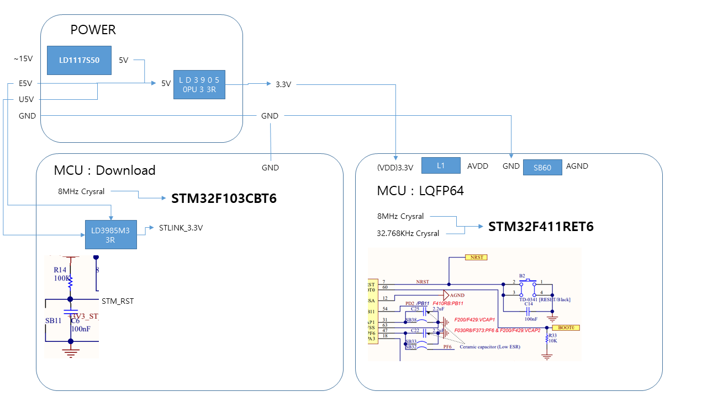
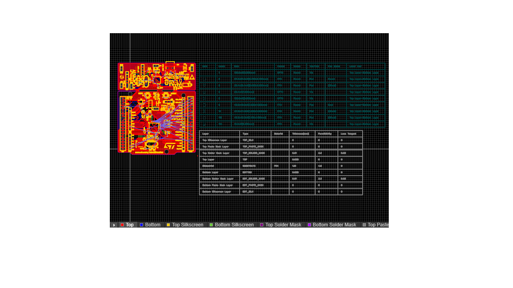
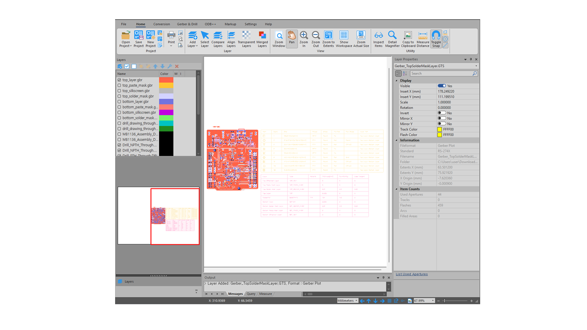
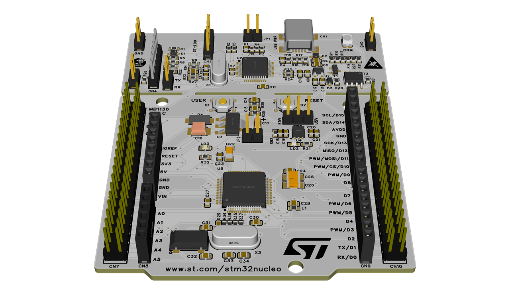
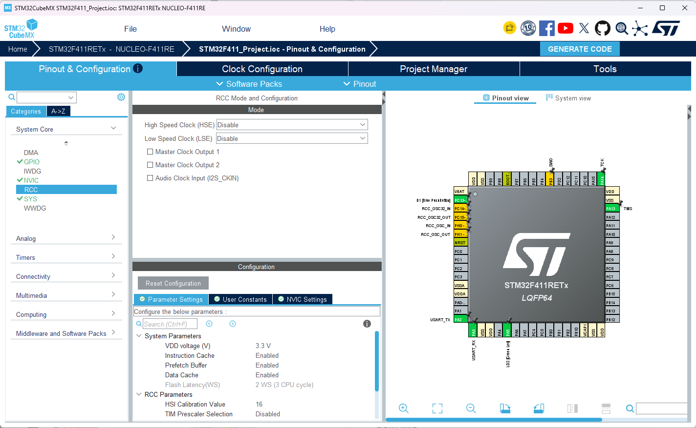
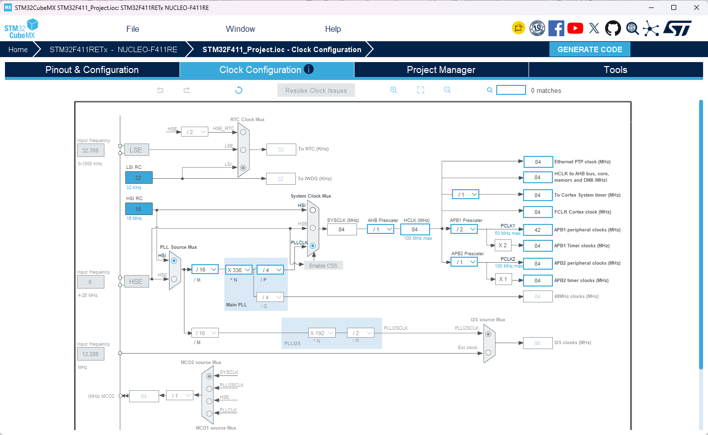
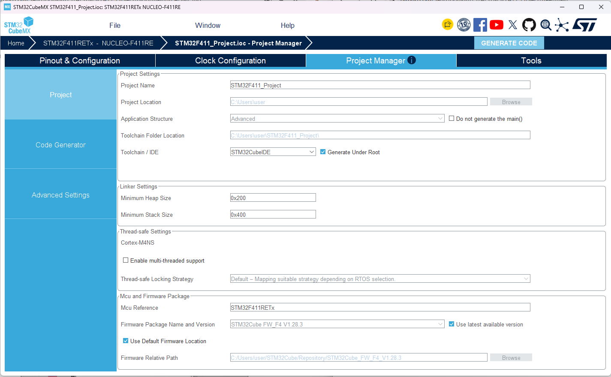

# STM32F411_Projects

## 1. STM32F411_Project

## Hardware

#### - 블록도
  "블록도"

#### - 회로도
  "회로도"

#### - 거버파일
  "거버파일"

#### - 3D배치
  "3D배치"

### STM32F411MX
#### - RCC 설정
 

#### - Clock 설정 
 

#### - STM32F411IDE 설정
 

## 2. F411_HC_SR04
- [1. F411_HC_SR04](./docs/F411_HC_SR04.md)
  
## 3. F411_LAB
- [1. LAB](./docs/F411_TASK_LAB.md)

### C언어 정리
- [1. C language](./docs/F411_C_language.md)
- [2. C vs Verilog HDL vs VHDL Comparison](./docs/F411_C_Verilog_HDL_VHDL.md)

